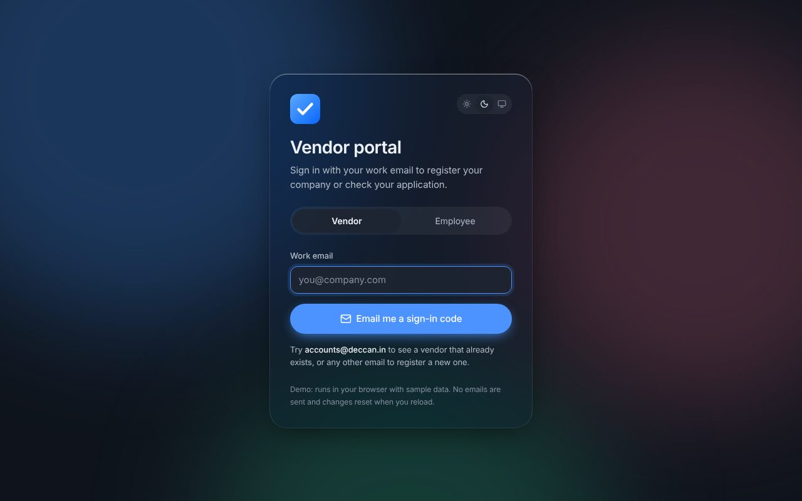
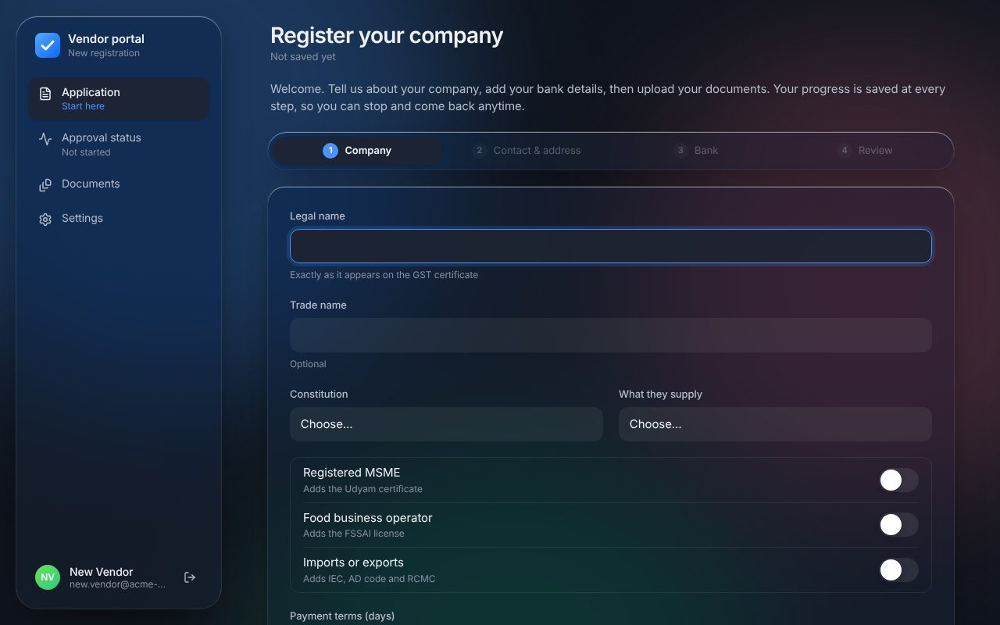
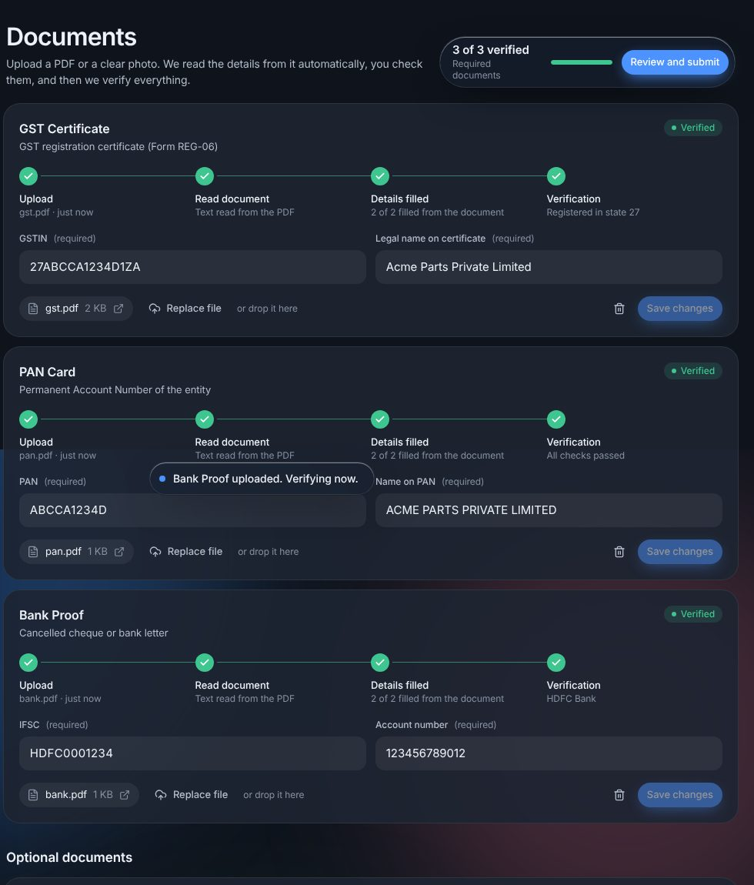
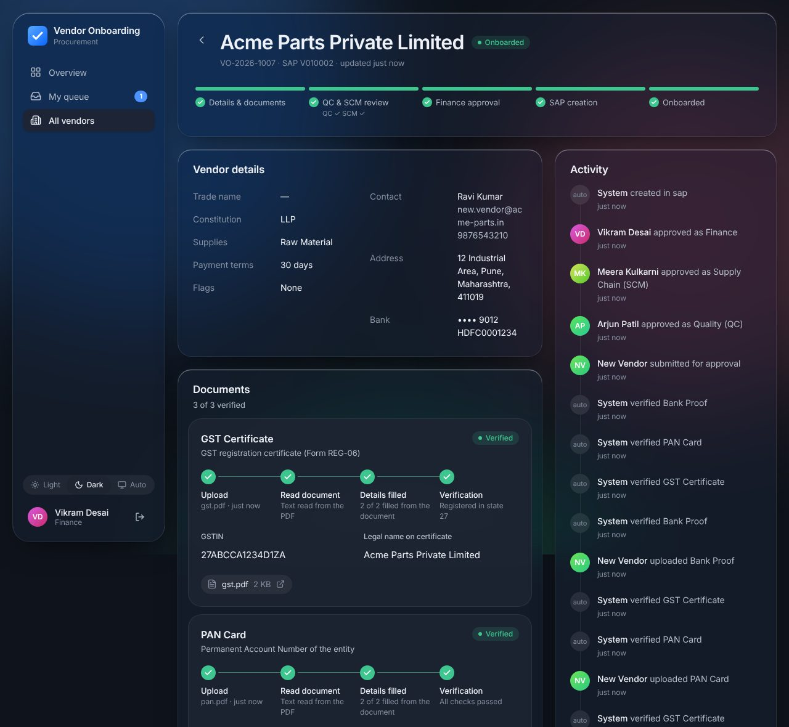

# Vendor Onboarding

**Live demo:** https://ayuszz.github.io/vendor-onboarding/ (runs entirely in your browser with no server, so SAP and sign-in emails are simulated. The demo skips the code step because it has no mail server; it never shows a code. The real app emails the code and never shows it.)

A coded replacement for a low-code vendor onboarding workflow. A requester collects a supplier's details and statutory documents. Each document is checked automatically. Quality (QC) and Supply Chain (SCM) review in parallel, Finance gives the final approval, and the vendor is created in SAP. If SAP fails, the system retries and keeps the same card code each time.

```
Draft ──submit──▶ QC & SCM review ──(both ✓)──▶ Finance ──approve──▶ SAP sync ──▶ Onboarded
  ▲                     │                          │                    │
  └──── Sent back ◀─────┴──────────────────────────┘                    └─▶ SAP error ──retry──┘
                        └────────── Reject (final) ─┘
```

## What it looks like

| Sign in | Company application |
|---|---|
|  |  |

| Documents: upload, read, fill, verify | Finance view: onboarded in SAP |
|---|---|
|  |  |

**Try the demo journey** (https://ayuszz.github.io/vendor-onboarding/):

1. Vendor tab: enter any email and press Continue (the demo has no mail server, so there is no code step). Fill in the company, contact and bank details.
2. Open **Documents** and upload a GST certificate, PAN card and cancelled cheque. Details are read from the file and filled in, then verified.
3. Submit. Sign out, use the **Employee** tab, and approve as `qc@example.com`, `scm@example.com` and then `finance@example.com` (password `Demo@1234`). The vendor is created in the mock SAP and shows as **Onboarded**.

## Quick start

Requires Node 22+.

```bash
npm install
cp .env.example .env        # then set JWT_SECRET to any 32+ character string
npm run dev                 # API on :4000, web on :5173
```

Open <http://localhost:5173>. There is one sign-in page with two tabs:

- **Vendor:** enter an email and a 6-digit code is emailed to it. The code is **only** delivered by email: the API never returns it, and the database stores only an HMAC of it. The vendor types the code from their inbox, the server checks it, and then signs them in. A new email goes straight to company registration and document upload. If a vendor record with that contact email already exists, it is linked to the account and the vendor sees its status.
  - With `MAILER=console` (the local default) no email is sent, and the email is printed to the **API terminal**, not the browser.
  - To send real emails, set `MAILER=smtp` and the `SMTP_*` settings in `.env`.
  - For quick local testing you can set `DEV_SHOW_OTP=true` to also show the code in the browser. The app refuses to start with that setting in production.
 The database is an embedded Postgres (PGlite) stored in `.data/`, so nothing else needs installing. API docs are at <http://localhost:4000/docs>.

```bash
npm test          # workflow engine, validators, OCR extractors, sign-in, full API flows
npm run typecheck
npm run build
```

For a production-like stack with real Postgres, a separate worker and nginx, run `docker compose up --build` and open <http://localhost:8080>.

## Project layout

```
packages/shared    Domain logic shared by API and web — no I/O
  workflow.ts      State machine: states, roles, decide(), availableActions()
  documents.ts     Document registry: fields, when required, verification rules
  validators.ts    GSTIN checksum, PAN, IFSC → bank, Udyam, FSSAI…
  vendor.ts        Profile schemas (zod) for drafts and for submission
  readiness.ts     The "what's blocking submit" checklist

apps/api           Fastify + Postgres
  services/        Vendor use cases (create, edit, upload, actions, lists)
  jobs/            Postgres job queue, document verification, SAP sync
  integrations/    SAP port: mock + SAP Business One Service Layer client
  db/              Driver (PGlite or pg), versioned migrations, seed
  auth.ts          HS256 JWT (swap for your IdP)
  storage.ts       File storage port (local disk; S3/Azure drop-in)

apps/web           React 19 + Vite + Tailwind 4 + TanStack Query
  pages/           Overview, queue/list, vendor editor (stepper), vendor detail
  components/      Glass UI kit, document card, journey rail
```

## Vendor portal

After signing in, a vendor gets a sidebar with four sections and one main screen:

- **Application:** company details, contact and address, bank details, then review and submit. New vendors start here.
- **Approval status:** the current stage (QC & SCM review, Finance, SAP, Onboarded), any changes your team has requested, and the activity history. A vendor who hasn't uploaded anything yet is taken to Documents instead.
- **Documents:** GST, PAN, bank proof, MSME, FSSAI and the other documents that apply to the company. Each document runs the same chain:

  **Upload → Read document → Details filled → Verification**

  1. The vendor chooses a PDF or a photo.
  2. The text is read in the browser. Digital PDFs use their embedded text layer (instant and exact). Photos and scanned PDFs go through OCR (Tesseract, self-hosted under `/ocr`, so files are never sent to a third party for OCR).
  3. The fields fill themselves. Each one is marked *From document*, or *Edited* if the vendor changes it.
  4. After upload, the server verifies everything again on its own: formats, the GSTIN checksum, the PAN inside the GSTIN, bank details against the profile, and expiry dates.

  The OCR result is stored with the document (method, confidence, fields read, fields edited), so reviewers can see which values came from the file and which were typed.
- **Settings:** account and company details, theme, and sign out.

The field extractors (`packages/shared/src/extract.ts`) look for labels and repair common OCR mix-ups (O↔0, I↔1, S↔5). They accept a value only after it passes validation, so a value that can't be read reliably is left empty rather than guessed.

## Design decisions

**The workflow is data, not screens.** `decide(snapshot, action, actor)` is a pure function. It returns the next state plus effects such as "record approval" or "queue SAP sync", and the API applies them in one transaction. Every rule is unit-tested. The UI calls the same function to decide which buttons to show, so it can never offer an action the server would refuse.

**One registry instead of 26 activities.** The low-code version had a separate "Upload X" and "Verify X" activity for each document. Here each document is one entry in `documents.ts`, which lists its fields, when it's required (for example, FSSAI only for food businesses and MOA only for companies) and its checks. To add a document type, you add one entry.

**Real verification, including cross-checks:**
- the GSTIN checksum is validated
- the PAN embedded in the GSTIN must match the PAN document
- a company's PAN must have holder type `C`
- the bank proof must match the profile's bank details
- expiry dates are enforced
- the bank is resolved from the IFSC prefix, which replaces the old 265-line bank-name lookup script

To call external providers (GSTN, NSDL, penny-drop), add them in `jobs/handlers.ts → verifyDocument`.

**SAP calls are safe to retry.**
- The card code is allocated once from a database sequence. This avoids the "read the latest code, then add one" race.
- Every retry reuses that code, and an "already exists" response counts as success.
- Transient errors back off exponentially. Permanent errors move the vendor to *SAP error* so Finance can retry it.
- The Service Layer client reuses its session instead of logging in on every call.

**Transactional outbox.** A job is inserted in the same transaction as the state change that needs it. Workers claim jobs with `FOR UPDATE SKIP LOCKED`, so you can run as many as you like.

**Other safeguards:**
- Optimistic locking: a stale write returns `409`.
- A complete audit trail of who did what and when.
- RBAC on every endpoint. Requesters see only their own vendors.
- Uploaded file types are detected from the file's bytes, never from the browser's claim.
- Only the last 4 digits of Aadhaar are stored.
- Secrets are redacted from logs.
- Config is validated at boot, so the app refuses to start when misconfigured.

**The UI is glass where it helps and solid where people read.** The sidebar, panels, action dock and dialogs use translucent blur. Inputs and document fields sit on a denser surface, so contrast never depends on what's behind them. The app supports light and dark mode, respects `prefers-reduced-motion` and `prefers-reduced-transparency`, works down to phone width with a bottom tab bar, and loads each page lazily.

## Going to production

1. **Sign-in.** Set `MAILER=smtp` with your mail server's `SMTP_*` settings and `MAIL_FROM`. The server checks the SMTP connection when it starts. Production refuses to start without SMTP, or with `DEV_SHOW_OTP=true`. Create staff accounts with hashed passwords (scrypt, see `services/auth.ts`), or put your company SSO in front of the Employee tab. `AUTH_MODE=dev` refuses to start when `NODE_ENV=production`.
2. **Database.** Set `DATABASE_URL` to a managed Postgres. Migrations run on boot. You can also run them with `npm run db:migrate -w @vo/api`.
3. **SAP.** Set `SAP_MODE=service_layer` and the `SAP_*` variables, then map `PayTermsGrpCode` and any custom user-defined fields in `integrations/sap.ts → toBusinessPartner`.
4. **Files.** Implement `FileStorage` for S3 or Azure Blob. It needs three methods.
5. **Scaling.** Run API replicas with `WORKER_ENABLED=false` and scale `npm run worker -w @vo/api` separately.
